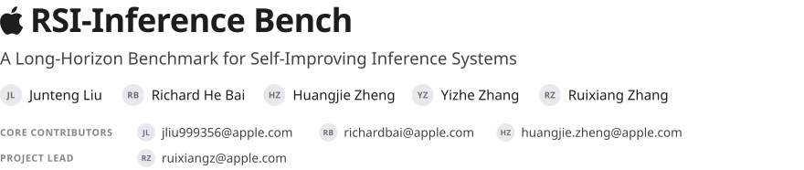
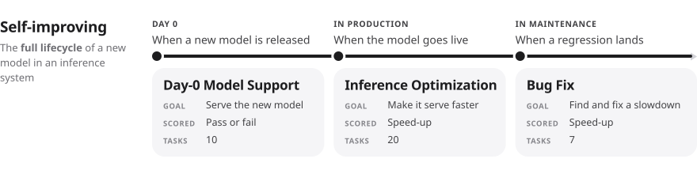
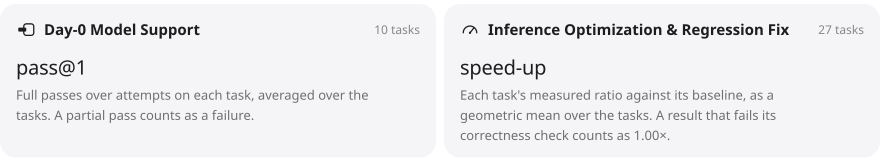

<p>
  <picture><source media="(prefers-color-scheme: dark)" srcset="assets/g-head-dark.svg"></picture>
</p>

[](CITATION.cff)
[](LICENSE)
[](https://www.python.org/)
[](#the-benchmark)

---

RSI-Inference Bench is a long-horizon benchmark for coding agents that improve the inference stack
of large language models. It follows a model through its life in a production engine, vLLM or
SGLang: supported on day 0, optimized after launch, and repaired when a regression lands. An agent
works on the real engine, on real GPUs, and is graded by running what it built.

## The Benchmark

<p>
  <picture><source media="(prefers-color-scheme: dark)" srcset="assets/g-rail-dark.svg"></picture><br>
  <picture><source media="(prefers-color-scheme: dark)" srcset="assets/g-lifecycle-dark.svg"></picture><br>
  <picture><source media="(prefers-color-scheme: dark)" srcset="assets/g-stack-dark.svg"></picture>
</p>

## Evaluate Your Own Model

Have a new model or agent? Run it on the benchmark and report its two scores.

1. **Get the code.** Clone this repository. It runs on Pier, a [Harbor](https://www.harborframework.com/docs/tasks)-compatible framework for evaluating coding agents.
2. **Run.** Run each task with your agent and model.

   ```bash
   uv sync
   uv run pier run -p tasks/<task> --env docker --agent <agent> --model <model>
   ```

3. **Report** one score per track, computed as the leaderboard computes it:

<p>
  <picture><source media="(prefers-color-scheme: dark)" srcset="assets/g-tracks-dark.svg"></picture>
</p>

## Citation

```bibtex
@misc{liu2026rsiinference,
  title        = {{RSI-Inference}: A Long-Horizon Benchmark for Self-Improving Inference Systems},
  author       = {Liu, Junteng and Bai, Richard He and Zheng, Huangjie and Zhang, Yizhe and Zhang, Ruixiang},
  year         = {2026},
  howpublished = {\url{https://github.com/apple-aiml-research/ml-rsi-inference-bench}},
  note         = {GitHub repository}
}
```

## License

Released under the [Apple Sample Code License](LICENSE).
